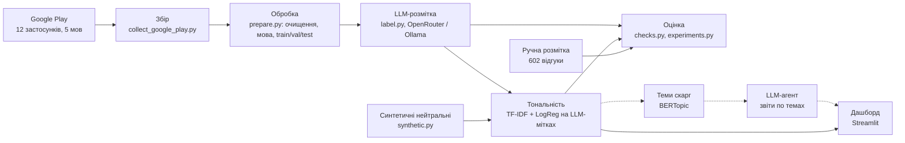

# Архітектура

Пунктир - те, що ще в роботі.

## Компоненти

- `src/data/collect_google_play.py` - збір відгуків, застосунки і ринки в `configs/apps.json` і `configs/apps_extra.json`
- `src/preprocessing/` - очищення тексту, визначення мови (правило по літерах + lingua), розбиття 80/10/10
- `src/llm/client.py` - один клієнт для OpenRouter і Ollama, провайдер і модель задаються в `.env`
- `src/llm/label.py` - розмітка відгуків LLM пачками по 20, порівняння з ручною розміткою
- `src/llm/synthetic.py` - генерація нейтральних відгуків (10 категорій, 5 мов, 4 типи) з перевіркою тим самим LLM-розмітником
- `src/sentiment/baseline.py` - TF-IDF + SVM на зірках
- `src/sentiment/threshold.py` - нейтральний клас через поріг упевненості
- `src/sentiment/experiments.py` - порівняння міток для навчання, перевірка на новій категорії
- `src/sentiment/zero_shot.py` - XLM-T без донавчання
- `src/evaluation/` - перевірки на ручній розмітці, замір швидкодії
- `src/dashboard/app.py` - дашборд
- `tests/` - автотести

## Дані

- `data/raw` - сирі збори з Google Play
- `data/processed/reviews.csv` - оброблені відгуки з мовою, слабкою міткою і split
- `data/labeling/to_label.xlsx` - ручна розмітка (602 відгуки)
- `data/llm/labels_<source>_<provider>.csv` - мітки від LLM
- `data/synthetic/neutral.csv` - синтетичні нейтральні відгуки
- `models/` - навчені моделі (не в git)
- `reports/` - метрики і графіки

## Основні рішення

- Google Play замість маркетплейсів: простіше збирати, відгуки саме про продукт
- lingua замість langdetect: 98% проти 88% на ручній розмітці
- суржик окремо не виділяю, мова відгуку - основна мова тексту
- нейтральний клас: спершу поріг упевненості на зірках, потім LLM-мітки + синтетика. Macro-F1 на ручній розмітці 0,80 проти 0,66 у SVM на зірках
- LLM-розмітка: хмарна Gemma 4 26B через OpenRouter (kappa 0,92 з ручною розміткою) або локальна Gemma 3 12B через Ollama, без передачі даних назовні (kappa 0,87)
- масову класифікацію робить швидка модель (0,2 с на 1000 відгуків на процесорі), LLM розмічає дані для навчання
- синтетика і LLM-мітки йдуть лише в навчання, метрики рахуються тільки на реальних відгуках з ручною розміткою