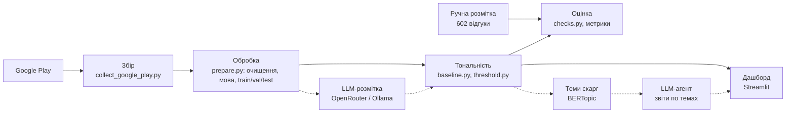

# Архітектура

Пунктир - те, що ще в роботі.

## Компоненти

- `src/data/collect_google_play.py` - збір відгуків, список застосунків у `configs/apps.json`
- `src/preprocessing/` - очищення тексту, визначення мови (правило по літерах + lingua), розбиття 80/10/10
- `src/sentiment/baseline.py` - TF-IDF + SVM, 3 класи
- `src/sentiment/threshold.py` - TF-IDF + логістична регресія (негатив/позитив), нейтральний через поріг
- `src/evaluation/` - перевірки на ручній розмітці, замір швидкодії
- `src/dashboard/app.py` - дашборд
- `tests/` - автотести

## Дані

- `data/raw` - сирі збори з Google Play
- `data/processed/reviews.csv` - оброблені відгуки з мовою, слабкою міткою і split
- `data/labeling/to_label.xlsx` - ручна розмітка
- `models/` - навчені моделі (не в git)
- `reports/` - метрики і графіки

## Основні рішення

- Google Play замість маркетплейсів: простіше збирати, відгуки саме про продукт
- lingua замість langdetect: 98% проти 88% на ручній розмітці
- суржик окремо не виділяю, мова відгуку - основна мова тексту
- нейтральний клас через поріг упевненості, бо 3 зірки - це здебільшого скарги
- метрики рахуються тільки на реальних відгуках з ручною розміткою, синтетика і LLM-мітки йдуть лише в навчання