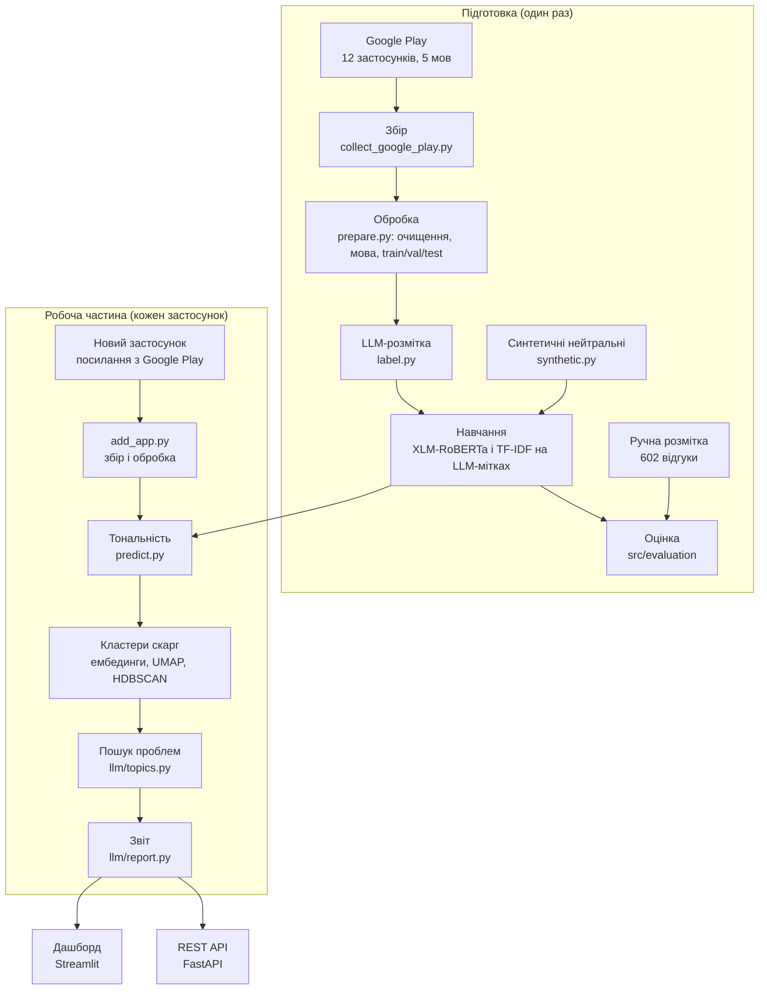

# Архітектура

Система має дві частини. Підготовка запускається один раз: збір, обробка, розмітка, навчання і оцінка моделей. Робоча частина працює з відгуками конкретного застосунку і показує результат у дашборді та через API. Обидві частини використовують ті самі модулі з `src`.

Усі числа у звітах (кількості, частки, тренди) рахує код. LLM формулює проблеми, розподіляє між ними скарги і пише тексти, а кожну її відповідь перевіряє код.

## Компоненти

- `src/data/collect_google_play.py` - збір відгуків, застосунки і ринки в `configs/apps.json` і `configs/apps_extra.json`
- `src/preprocessing/` - очищення тексту, визначення мови (правило по літерах + lingua), розбиття 80/10/10
- `src/llm/client.py` - один клієнт для OpenRouter і Ollama, провайдер і модель задаються в `.env`
- `src/llm/label.py` - розмітка відгуків LLM пачками по 20
- `src/llm/synthetic.py` - нейтральні відгуки (10 категорій, 5 мов, 4 типи) з перевіркою тим самим LLM-розмітником
- `src/sentiment/` - бейзлайн TF-IDF + SVM, поріг упевненості, експерименти з мітками, XLM-T без донавчання, донавчання XLM-RoBERTa (`finetune_xlmr.py`) і вибір моделі (`predict.py`)
- `src/topics/` - ембединги, кластеризація, порівняння BERTopic, k-means і LDA (`compare.py`), кластери скарг одного застосунку (`app_topics.py`)
- `src/llm/topics.py` - пошук проблем: список проблем за кластерами, розподіл скарг, дошук, об'єднання дублікатів, частки і тренди
- `src/llm/report.py` - звіт: деталі проблем зі скаргами, підсумок, рекомендації, переклад цитат
- `src/pipeline/score.py` - тональність усіх відгуків основного набору
- `src/pipeline/add_app.py` - додавання, оновлення і видалення застосунку за посиланням
- `src/evaluation/` - перевірки на ручній розмітці, порівняння моделей з довірчими інтервалами, мовний склад тем, ручна перевірка проблем, повторні запуски, замір швидкодії
- `src/dashboard/app.py` - дашборд: огляд, теми скарг, звіт, додавання застосунку
- `src/api/main.py` - REST API, документація на `/docs`
- `tests/` - автотести (67)

## Дані

- `data/raw` - сирі збори з Google Play
- `data/processed/reviews.csv` - оброблені відгуки з мовою, слабкою міткою і split
- `data/processed/predictions.csv` - тональність і впевненість моделі для кожного відгуку
- `data/labeling/` - ручна розмітка (602 відгуки) і файли ручної перевірки проблем
- `data/llm/` - мітки від LLM
- `data/synthetic/neutral.csv` - синтетичні нейтральні відгуки
- `data/added/` - додані застосунки: один CSV на застосунок і реєстр `apps.json`
- `data/apps/` - проблеми (`<застосунок>_described.json`) і звіти (`<застосунок>_report.md`, `.json`)
- `models/` - навчені моделі
- `reports/metrics`, `reports/figures`, `reports/topics` - метрики, графіки і теми з ручною перевіркою

Папок `data` і `models` у репозиторії немає, вони відновлюються скриптами з README.

## Розгортання

`docker compose up` запускає два сервіси з одного образу: дашборд на порту 8501 і API на 8000. Папки `data` і `models` підключаються з диска, ключ LLM береться з `.env` і в образ не потрапляє. В образі PyTorch для процесора.

## Основні рішення

- Google Play замість маркетплейсів: простіше збирати, відгуки саме про застосунок
- lingua замість langdetect: 97,6% проти 87,7% на ручній перевірці
- суржик окремо не виділяю, мова відгуку - основна мова тексту
- мітки для навчання від LLM замість зірок: каппа Коена з ручною розміткою 0,92 у хмарної Gemma 4 26B і 0,87 у локальної Gemma 3 12B проти 0,69 у зірок
- синтетика і LLM-мітки йдуть лише в навчання, метрики рахуються тільки на реальних відгуках з ручною розміткою
- основна модель - донавчена XLM-RoBERTa (macro-F1 0,837 проти 0,661 у бейзлайну). Режим `SENTIMENT_MODEL=auto` бере її, якщо є відеокарта, інакше TF-IDF (0,802, 0,2 с на 1000 відгуків на процесорі)
- кластери HDBSCAN - лише вхідні дані для LLM, бо один кластер часто змішує різні проблеми
- фіксований конвеєр замість LLM-агента на LangChain: порядок кроків відомий, кожну відповідь перевіряє код
- файли CSV і JSON замість PostgreSQL і MLflow: для MVP з одним користувачем цього досить